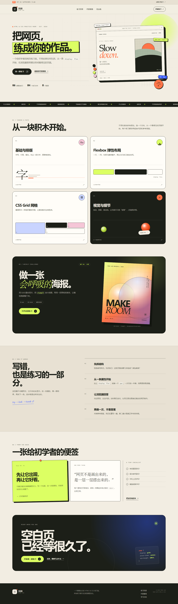

# 页间 PAGE LAB

一个给初学者的 **HTML & CSS 练习网站**。不用安装依赖，打开浏览器就能临摹版式、调整样式，并实时看到结果。



## 在线地址

**<https://page-lab-practice-zhang.netlify.app>**

长期托管在 Netlify，已开启 HTTPS，无需登录即可访问。

GitHub 仓库：<https://github.com/kiki11111111916/page-lab>

## 立即开始

直接双击 `index.html` 即可。也可以在当前目录启动一个本地服务器：

```bash
python -m http.server 8000
```

然后访问 <http://127.0.0.1:8000/>。

## 三个页面

| 页面 | 内容 |
| --- | --- |
| `index.html` | 首页：学习方向、本周挑战、练习方法 |
| `practice.html` | 练习目录：6 道练习，按基础排版 / Flexbox / Grid / 视觉细节筛选 |
| `playground.html` | 代码操场：编辑 HTML 与 CSS，实时预览，切换关卡，查看提示和参考答案 |

## 练习场功能

- **实时预览**：输入后自动刷新右侧 iframe，也可用 `Ctrl / ⌘ + Enter` 立即运行。
- **6 道练习 + 自由创作**：名片、价格卡、周末相册、按钮、侧边栏、海报。
- **起始代码**：每道题都预留了结构、基础样式和 `TODO` 注释。
- **提示与参考答案**：参考答案只在独立模式中载入，点击「回到我的版本」即可恢复。
- **草稿自动保存**：输入会写入 `localStorage`，刷新或下次打开时恢复。
- **新窗口预览**：用完整浏览器尺寸检查自己写出的页面。
- **响应式**：桌面、平板、手机均可使用，并适配键盘导航与减少动态效果偏好。

## 目录结构

```text
page-lab/
├─ index.html              # 首页
├─ practice.html           # 练习目录
├─ playground.html         # 代码操场
├─ styles.css              # 全站样式与响应式规则
├─ app.js                  # 导航、筛选、实时编辑器
├─ favicon.svg
├─ preview/                # 页面预览截图
└─ README.md
```

## 技术说明

- HTML5 + CSS3 + 原生 JavaScript
- 无框架、无构建步骤、无第三方依赖
- 练习场使用 `iframe.srcdoc` 隔离用户代码，并设置 `sandbox`
- 草稿保存在浏览器本地，不会上传到任何服务器
- 目录筛选使用 CSS `:has()` 配合原生表单控件，键盘也可以操作

## 小提示

打开练习场后，先看「完成标准」，再从一条属性开始改。卡住时展开提示；实在没有头绪，再看参考答案。关掉答案自己重写一遍，才算真正学会。
